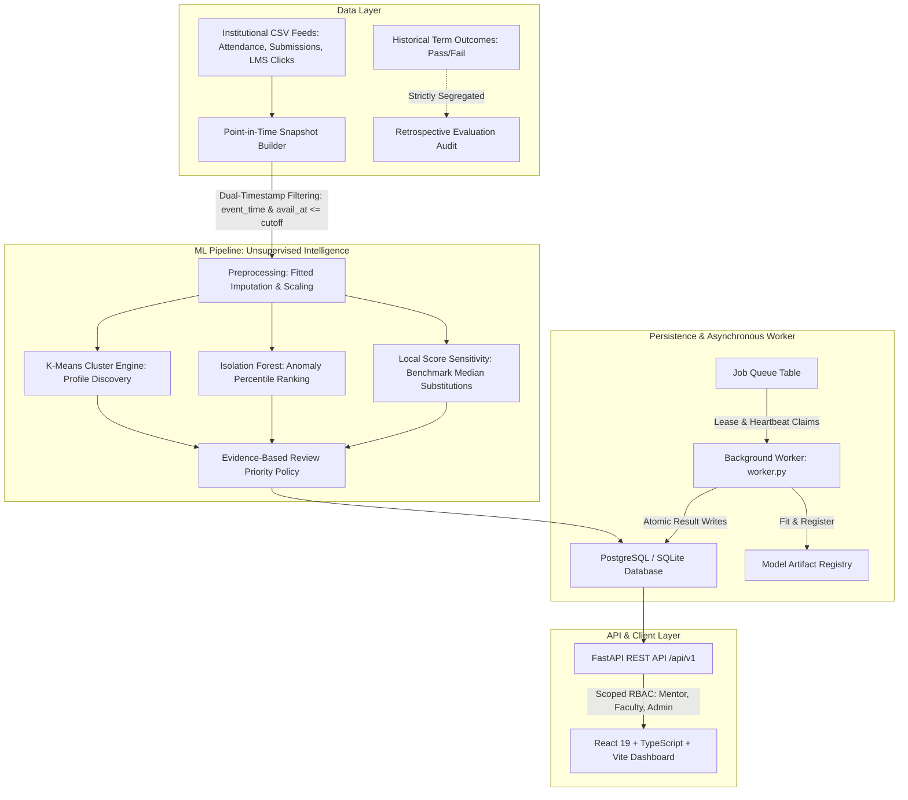

# Academic Risk Monitor — Architecture & System Design

## 1. Executive Overview

**Academic Risk Monitor** is an enterprise-grade web application and machine learning platform engineered for university faculty, academic mentors, and student success advisors. The platform discovers early academic support needs using **unsupervised machine learning** (K-Means Clustering + Isolation Forest Anomaly Detection) coupled with a deterministic, evidence-based review priority policy.

The primary unit of analysis is **one student–course enrollment at one early checkpoint (Weeks 2, 4, 6)**. A student enrolled in multiple courses possesses distinct risk profiles, attendance patterns, and mentor caseload assignments.

---

## 2. Component & Data-Flow Diagram

---

## 3. Asynchronous Worker & Job Lease Lifecycle

To guarantee fault-tolerant, atomic operations for long-running batch scoring and training:
1. **Transactional Claim**: Workers claim jobs from the `job_runs` table within a transactional boundary, setting `status = 'claimed'` and an active lease expiration (`lease_expires_at = now + 300s`).
2. **Heartbeat Updates**: Workers periodically transmit heartbeat signals, refreshing `lease_expires_at` and reporting percentage progress.
3. **Stale Lease Recovery**: If a worker crashes or abandons a lease, subsequent worker polls automatically identify expired leases and reclaim them for execution.
4. **Atomic Result Publication**: Model scoring runs commit feature snapshots and published assessments atomically in a single transaction; failed jobs never overwrite previously active published assessments.
