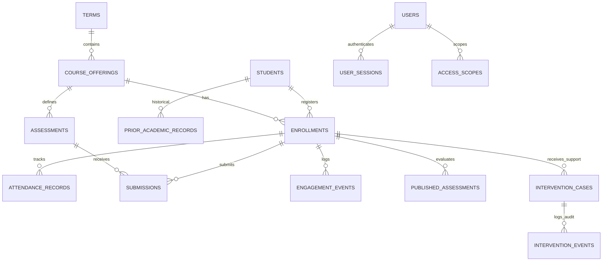

# Academic Risk Monitor — Database Schema & Constraints

The relational schema is implemented with SQLAlchemy and Alembic, supporting SQLite for local zero-dependency development and PostgreSQL for production containers.

---

## 1. Entity-Relationship Diagram

---

## 2. Table Specifications

### Core Academics
* `terms`: Primary key `term_code` (e.g. `2013J`, `2013B`, `2014B`, `2014J`), start and end dates.
* `course_offerings`: Primary key `offering_id`, foreign key to `terms.term_code`, course code, section, faculty assignment.
* `students`: Core student table, demographics excluded from ML inputs to ensure ethical AI.
* `enrollments`: Unit of analysis (`enrollment_id`), student-course pair, assigned mentor.
* `attendance_records`: Presence status (`present`, `absent`, `excused`, `unrecorded`), dual timestamps (`event_timestamp_utc`, `available_at_utc`).
* `assessments` & `submissions`: Assessment definitions with deadlines, and point-in-time submission marks.
* `engagement_events`: LMS interactions (login, resource views, study durations, click counts).
* `prior_academic_records`: Pre-matriculation GPA, earned credits, tier.
* `final_outcomes`: Strictly isolated retrospective outcomes (`Pass`, `Fail`, `Withdrawn`).

### Scoring & ML Registry
* `feature_snapshots`: Checkpoint-specific feature vectors and coverage flags.
* `model_artifacts`: Versioned candidate and active model bundles with SHA-256 integrity checksums.
* `scoring_runs`: Execution logs tracking total scored, priority counts, and model version.
* `published_assessments`: Published results for student enrollments: priority, cluster ID, anomaly percentile, policy path, and local score sensitivities.
* `job_runs`: Transactional job queue with worker leases and progress tracking.

### Interventions & Audit
* `intervention_cases`: Support cases with assigned mentors, support action types, follow-up deadlines, and overdue calculation.
* `intervention_events`: Immutable audit trail tracking who changed what, when, and progress notes.
